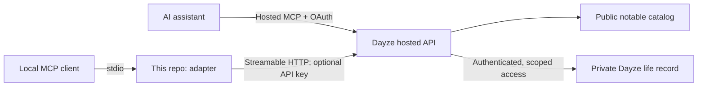

<p align="center"></p>

# Dayze MCP

**Give your AI the context of your real life: your people, plans and memories.**

Dayze connects a private, correctable life record to AI assistants through the [Model Context Protocol](https://modelcontextprotocol.io/). Instead of re-explaining who someone is or what you planned, connect Dayze and ask a question grounded in the information you saved.

[Connect Dayze](https://dayze.com/mcp) · [Agent documentation](https://dayze.com/docs/agents) · [Development](CONTRIBUTING.md) · [Security](SECURITY.md)

## What this repository contains

Built by [Luke / gohluke](https://github.com/gohluke) as the public integration layer for [Dayze](https://dayze.com):

- **Client integrations** for Claude Code, Cursor and Codex, with hosted MCP connection metadata and a reusable life-context skill.
- **A stdio adapter** for clients that need a local process, using the official MCP SDK for both sides of the connection.
- **Executable checks** for the stdio lifecycle, authenticated discovery, HTTP and MCP failures, SSE responses, deadlines, redirects and credential redaction.

The Dayze application, hosted tools, account storage and OAuth service are maintained separately. This repository is an integration client, not a self-hosted copy of the Dayze backend. You can inspect and test the adapter without access to private infrastructure or an account.

## See the workflow

An illustrative conversation using **fictional data**, not a live account result:

> **You:** What should I remember before coffee with Maya this week?
>
> **Assistant:** Reads `get_context_pack`, resolves Maya from your Dayze Contacts and checks the available linked interactions. It can summarize the saved plan and notes with source links, or say that context is missing.
>
> **You:** Move coffee to Friday.
>
> **Assistant:** Uses an available write tool only when the connection has the required permission and you have authorized the change. It returns the actual save receipt, rather than treating a drafted answer as a saved record.

Public figures are a separate workflow: `notable_search` → `notable_pack`. They never substitute for your private contacts.

For a repeatable local demonstration, run `npm ci --ignore-scripts && npm test`. The tests start the real stdio executable and use synthetic HTTP fixtures; they never read or write a Dayze account. An optional metadata-only live probe is described below.

## Connect your assistant

**Recommended endpoint:** `https://dayze.com/api/mcp` — Streamable HTTP with browser-based Dayze OAuth. No API key needs to be pasted into a conversation.

### Claude Code

```sh
claude plugin marketplace add gohluke/dayze-mcp
claude plugin install dayze@dayze
claude mcp login plugin:dayze:dayze
```

You can also authenticate from `/mcp` in a session. Then ask: “Use Dayze to pull my context pack for this week.” The plugin supports `DAYZE_MCP_URL` as a hosted-endpoint override through Claude Code's environment configuration.

### Cursor and other HTTP MCP clients

Add this server to your client's MCP configuration, then use its Connect/authenticate action:

```json
{
  "mcpServers": {
    "dayze": {
      "url": "https://dayze.com/api/mcp"
    }
  }
}
```

Some clients additionally require a transport field; use that client's documented Streamable HTTP format. The repo retains separate [Cursor](mcp.json), [Claude/Codex](.mcp.json) and plugin compatibility manifests. See [Cursor's MCP documentation](https://cursor.com/docs/context/mcp).

### ChatGPT

Use the hosted endpoint and select OAuth when adding a custom MCP connection. Availability and setup controls depend on your account/workspace. See [ChatGPT setup](README-CHATGPT.md) and [OpenAI's connection guide](https://developers.openai.com/plugins/deploy/connect-chatgpt).

**A profile name is not a permission guarantee.** The compact endpoint, `https://dayze.com/api/mcp?tools_profile=compact`, has an evolving catalog that can include write tools. Review the discovered tools and granted scopes; do not assume “compact” means read-only.

## Local stdio adapter

Requires **Node.js 22 or later**. Node 22 and 24 are covered by the CI matrix.

```sh
git clone https://github.com/gohluke/dayze-mcp.git
cd dayze-mcp
npm ci --ignore-scripts
npm start
```

`npm start` waits for MCP messages on stdin. It is not an interactive chat prompt. Configure your MCP client to run `node` with the absolute path to `server.mjs`; the process reserves stdout for JSON-RPC.

```json
{
  "mcpServers": {
    "dayze-local": {
      "command": "node",
      "args": ["/absolute/path/to/dayze-mcp/server.mjs"]
    }
  }
}
```

**Without a key:** the adapter advertises four bundled, public notable-people schemas, even offline. Calling them still needs a network connection. Private calls are rejected locally. The schemas are a small compatibility snapshot, not the hosted catalog; see [their provenance](docs/PUBLIC_CATALOG.md).

**With a key:** inject `DAYZE_API_KEY` into the process using your client's secret/environment configuration. Use an existing `dayze_k_…` key with the least permissions needed. Do not put the key in this repository, a command argument, issue, screenshot or chat. The adapter forwards it as a Bearer header only to the fixed `https://dayze.com/api/mcp` endpoint. It lists the live tools allowed by that key, preserves pagination and reports discovery errors instead of silently claiming private tools are available.

The adapter does **not** implement an OAuth login flow or persist tokens. Use a direct hosted connection for OAuth. It has a 30-second request deadline, makes no automatic tool-call retries and does not implement x402 payments. A timeout can leave a write's outcome uncertain: inspect Dayze before retrying, and reuse the original idempotency key when the tool supports one.

## How it fits together



The adapter deliberately stays small:

- **Protocol handling belongs to the SDK.** Initialization, sessions, SSE framing and result validation use the maintained MCP SDK rather than a hand-written “last data line” parser.
- **Authentication is explicit.** Public mode cannot forward private calls. Key mode uses the hosted authorization policy; tool discovery is not a substitute for consent.
- **Failures are actionable.** Authentication, permissions, payment, rate limits, timeouts and protocol errors remain distinguishable. Locally generated failures omit arguments and raw upstream error bodies.
- **Writes are not retried automatically.** A dropped response does not prove a write failed.

## Verify it yourself

```sh
npm run check          # Syntax, package versions and plugin references
npm test               # Full offline/synthetic test suite, including real stdio
npm audit --omit=dev   # Current dependency advisory check
npm pack --dry-run     # Inspect the npm package contents
npm run smoke:live     # Optional: hosted health + initialize + tools/list only
```

The live probe sends no credentials, selects no user records, makes no tool calls and triggers no payments. It proves metadata connectivity, not a signed-in workflow. Tests and CI do not require production secrets. [CI runs](https://github.com/gohluke/dayze-mcp/actions/workflows/ci.yml) provide the results for each revision; a local pass alone does not prove a marketplace installation works.

For container-based stdio hosts, build the included Dockerfile and keep stdin open (`docker run --rm -i …`). It installs the lockfile and runs as a non-root user.

## Permissions and limits

Private tools depend on the selected hosted profile and scopes granted to the connection. Granular scopes include `context.read`, `context.write` and `context.edit`; legacy `context` grants remain supported. Ask for the minimum access and inspect the OAuth consent screen. Revoke connections in Dayze's Connected apps settings.

Public notable calls have an anonymous allowance and may return **402 Payment Required**. Consult the current hosted descriptions for availability and pricing. The adapter neither guarantees free calls nor spends money automatically.

This package's version describes the integration files and adapter. The hosted API has its own release cycle; its [health endpoint](https://dayze.com/api/mcp/health) reports that version. Tool counts and external directory review statuses are intentionally not hard-coded here.

## Contributing and license

Bug reports and focused pull requests are welcome. Start with [CONTRIBUTING.md](CONTRIBUTING.md); report sensitive issues through [SECURITY.md](SECURITY.md). Maintainers can use [PUBLISH.md](PUBLISH.md) for release checks.

The code, documentation and metadata in this repository are [MIT licensed](LICENSE). The separately hosted Dayze product and API remain proprietary.
